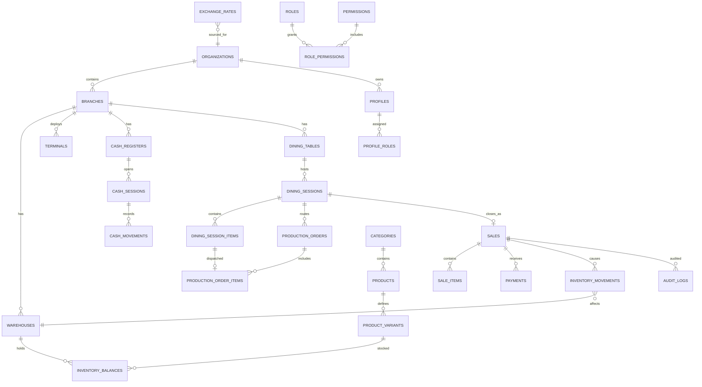

# Esquema de datos propuesto

Este documento describe el diseño lógico. No contiene migración ejecutada ni
creación de tablas remotas.

## 1. Convenciones

- UUID como clave primaria distribuida.
- Timestamps con zona horaria (`timestamptz`) en PostgreSQL.
- ISO 8601 en SQLite, preferentemente UTC.
- Importes monetarios como `BIGINT` en unidades menores o `TEXT` Decimal.
- Eliminación lógica por `deleted_at` en catálogos; operaciones append-only.
- Todas las entidades operativas incluyen `organization_id`.
- Versionado optimista con `updated_at` y `version`.
- Identificadores Beta se conservan como `beta_origin_id`, no como PK.

## 2. Diagrama lógico



## 3. PostgreSQL

### Seguridad y organización

```sql
organizations(id uuid pk, name text, tax_id text, status text,
  created_at timestamptz, updated_at timestamptz, version bigint, deleted_at timestamptz);

branches(id uuid pk, organization_id uuid fk, name text, code text,
  timezone text, default_currency text, status text,
  created_at timestamptz, updated_at timestamptz, version bigint, deleted_at timestamptz);

terminals(id uuid pk, organization_id uuid fk, branch_id uuid fk,
  name text, public_key text, platform text, app_version text,
  status text, registered_at timestamptz, last_seen_at timestamptz,
  revoked_at timestamptz, beta_origin_id text,
  created_at timestamptz, updated_at timestamptz, version bigint);

warehouses(id uuid pk, organization_id uuid fk, branch_id uuid fk,
  name text, code text, status text,
  created_at timestamptz, updated_at timestamptz, version bigint, deleted_at timestamptz);

profiles(id uuid pk -- auth.users.id,
  organization_id uuid fk, display_name text, status text,
  created_at timestamptz, updated_at timestamptz, deleted_at timestamptz);
```

Restricciones:

- `profiles.id` coincide con `auth.users.id`.
- Un terminal pertenece a una sola organización y sucursal.
- Código de sucursal y almacén únicos dentro de organización.
- Revocación registra timestamp y no borra identidad.

### Roles y permisos

```sql
roles(id uuid pk, organization_id uuid fk, code text, name text,
  is_system boolean, created_at timestamptz, updated_at timestamptz);

permissions(id uuid pk, code text unique, description text,
  created_at timestamptz);

profile_roles(profile_id uuid fk, role_id uuid fk,
  organization_id uuid fk, assigned_by uuid fk,
  assigned_at timestamptz, primary key(profile_id, role_id));

role_permissions(role_id uuid fk, permission_id uuid fk,
  scope text, primary key(role_id, permission_id));
```

Roles mínimos: `org_admin`, `manager`, `cashier`, `waiter`, `kitchen`, `bar`.
No exponer permisos por interfaz solamente.

### Catálogo e inventario

```sql
categories(id uuid pk, organization_id uuid fk, parent_id uuid fk,
  name text, sort_order integer, active boolean,
  beta_origin_id text, created_at timestamptz, updated_at timestamptz,
  version bigint, deleted_at timestamptz);

products(id uuid pk, organization_id uuid fk, category_id uuid fk,
  sku text, name text, description text,
  base_currency text, price_minor bigint, cost_minor bigint,
  offline_sellable boolean, fulfillment_station text, is_synthetic boolean,
  active boolean,
  beta_origin_id text, created_at timestamptz, updated_at timestamptz,
  version bigint, deleted_at timestamptz);

product_variants(id uuid pk, organization_id uuid fk, product_id uuid fk,
  sku text, name text, price_minor bigint, cost_minor bigint,
  active boolean, beta_origin_id text,
  created_at timestamptz, updated_at timestamptz,
  version bigint, deleted_at timestamptz);

inventory_movements(id uuid pk, organization_id uuid fk,
  warehouse_id uuid fk, variant_id uuid fk, sale_id uuid null fk,
  movement_type text, quantity_minor bigint, unit_cost_minor bigint,
  reason text, source_terminal_id uuid fk, source_beta_id text,
  idempotency_key text unique, before_version bigint,
  created_by uuid fk, created_at timestamptz, synced_at timestamptz);

inventory_balances(id uuid pk, organization_id uuid fk,
  warehouse_id uuid fk, variant_id uuid fk,
  quantity_minor bigint, reserved_minor bigint,
  version bigint, updated_at timestamptz,
  unique(warehouse_id, variant_id));
```

`quantity_minor` debe usar unidades de inventario, no unidades monetarias.
`inventory_movements` es append-only: ninguna actualización o borrado.
`fulfillment_station` admite `KITCHEN`, `BAR` o `UNASSIGNED`; productos sin
clasificación explícita no se enrutan automáticamente a producción.
`is_synthetic` identifica fixtures locales de demostración: no generan outbox
de catálogo, no se aceptan en ventas ni comandas sincronizables y deben
reemplazarse por catálogo autorizado antes de operar.

### Ventas y pagos

```sql
sales(id uuid pk, organization_id uuid fk, branch_id uuid fk,
  terminal_id uuid fk, cash_session_id uuid null fk,
  sale_number text, status text, sale_kind text,
  total_currency text, total_minor bigint,
  exchange_rate_snapshot_id uuid null fk,
  beta_origin_id text, idempotency_key text unique,
  base_version bigint, created_by uuid fk,
  created_at timestamptz, updated_at timestamptz, closed_at timestamptz);

sale_items(id uuid pk, organization_id uuid fk, sale_id uuid fk,
  variant_id uuid fk, quantity integer, unit_price_minor bigint,
  subtotal_minor bigint, tax_minor bigint, line_currency text,
  created_at timestamptz);

payments(id uuid pk, organization_id uuid fk, sale_id uuid fk,
  method text, amount_minor bigint, currency_code text,
  exchange_rate_snapshot_id uuid null fk,
  original_amount_minor bigint, original_currency_code text,
  reference text, status text, idempotency_key text unique,
  created_at timestamptz);
```

Estados propuestos:

- sale: `open`, `paid`, `void_pending`, `voided`, `sync_conflict`, `closed`.
- payment: `pending`, `confirmed`, `voided`, `failed`.

Una venta confirmada no se actualiza: una anulación crea su enlace y movimiento.

### Caja y tasas

```sql
cash_registers(id uuid pk, organization_id uuid fk, branch_id uuid fk,
  name text, status text, created_at timestamptz,
  updated_at timestamptz, deleted_at timestamptz);

cash_sessions(id uuid pk, organization_id uuid fk, cash_register_id uuid fk,
  terminal_id uuid fk, profile_id uuid fk,
  opening_minor jsonb, status text, opened_at timestamptz,
  closed_at timestamptz, closing_minor jsonb,
  idempotency_key text unique, base_version bigint);

cash_movements(id uuid pk, organization_id uuid fk, cash_session_id uuid fk,
  movement_type text, category text, amount_minor bigint,
  currency_code text, sale_id uuid null fk, reason text,
  idempotency_key text unique, created_by uuid fk, created_at timestamptz);

exchange_rates(id uuid pk, organization_id uuid fk,
  base_currency text, quote_currency text, rate_minor_units bigint,
  effective_from timestamptz, effective_to timestamptz null,
  source text, source_reference text, created_at timestamptz,
  created_by uuid fk, unique(base_currency, quote_currency, effective_from));
```

### Auditoría y sincronización

```sql
audit_logs(id uuid pk, organization_id uuid fk, branch_id uuid fk,
  terminal_id uuid fk, profile_id uuid fk, action text,
  entity_type text, entity_id uuid, reason text,
  before_json jsonb, after_json jsonb,
  occurred_at timestamptz, immutable_hash text);

sync_receipts(id uuid pk, organization_id uuid fk, terminal_id uuid fk,
  idempotency_key text unique, operation_type text,
  entity_id uuid, result_status text, remote_version bigint,
  payload_hash text, received_at timestamptz);

sync_events(id uuid pk, organization_id uuid fk, terminal_id uuid fk,
  operation_type text, entity_type text, entity_id uuid,
  idempotency_key text, event_type text, event_cursor text,
  base_version bigint, payload jsonb, received_at timestamptz,
  unique(idempotency_key, entity_id));
```

`audit_logs` no admite UPDATE/DELETE; `sync_receipts` garantiza idempotencia.

### Salón y producción

```sql
dining_tables(id uuid pk, organization_id uuid fk, branch_id uuid fk,
  name text, capacity integer, status text, active boolean, sort_order integer,
  created_at timestamptz, updated_at timestamptz, unique(branch_id, name));

dining_sessions(id uuid pk, organization_id uuid fk, dining_table_id uuid fk,
  terminal_id uuid fk, profile_id uuid fk, status text,
  opened_at timestamptz, closed_at timestamptz,
  idempotency_key text unique, base_version bigint);

dining_session_items(id uuid pk, organization_id uuid fk,
  dining_session_id uuid fk, variant_id uuid fk, product_name text,
  quantity numeric, unit_price_minor bigint, currency_code text,
  fulfillment_station text, notes text, status text,
  sent_at timestamptz, created_at timestamptz, updated_at timestamptz);

production_orders(id uuid pk, organization_id uuid fk,
  dining_session_id uuid fk, dining_table_id uuid fk, order_number text,
  station text, status text, created_by uuid fk, created_at timestamptz,
  updated_at timestamptz, ready_at timestamptz, delivered_at timestamptz,
  base_version bigint);

production_order_items(id uuid pk, organization_id uuid fk,
  production_order_id uuid fk, dining_session_item_id uuid fk unique,
  created_at timestamptz);

-- sales.dining_session_id is nullable for direct POS sales.
```

La sesión solo puede cerrarse al completar su venta dentro de la misma
transacción. Las reservas se convierten en consumos de inventario al confirmar
el pago; las órdenes conservan historial de estación y transición de estado.

## 4. Índices

- `(organization_id, branch_id, created_at)` en ventas y movimientos.
- `(organization_id, sku)` en productos/variantes.
- `(warehouse_id, variant_id)` en inventario.
- `(sale_id)` y `(idempotency_key)` en pagos.
- `(terminal_id, next_attempt_at)` en cola local.
- `(organization_id, effective_from, effective_to)` en tasas.
- `(entity_type, entity_id, occurred_at)` en auditoría.
- `(idempotency_key)` único en recibos y operaciones comerciales.

## 5. SQLite espejo

Las tablas centrales se replican con nombres idénticos o prefijos estándar:

- organizaciones, sucursales, terminales, almacenes.
- perfiles, roles, permisos y asignaciones.
- productos, categorías, variantes y balances.
- ventas, items, pagos y movimientos de inventario.
- caja y sesiones.
- tasas e auditoría local.
- `sync_outbox`, `sync_inbox`, `sync_receipts`, `sync_events`,
  `sync_cursors`, `sync_errors`.
- `schema_migrations`.

SQLite usa claves `TEXT` UUID, `INTEGER` para minor units, JSON como `TEXT`,
timestamps ISO8601 y `PRAGMA foreign_keys = ON`.

## Implementación SQLite

Las migraciones ejecutables v1-v5 están en
`packages/data_local/lib/src/migrations.dart`.

v1 crea identidad local, catálogo, inventario, ventas, pagos, caja, auditoría y
sincronización; v2 agrega configuración del terminal y limita a una sesión de
caja abierta por registro; v3 añade mesas, sesiones, reservas a través de
`inventory_balances.reserved_minor`, comandas de cocina/barra y estación de
producto; v4 marca explícitamente los productos sintéticos; v5 agrega salt/hash
del PIN, sesiones locales de perfil y preferencias de salida por estación.
Estas credenciales son exclusivas de SQLite local y no se copian al modelo
PostgreSQL ni a la outbox. La confirmación de venta y cierre de mesa, igual que los movimientos
manuales y la apertura/cierre de caja, se guardan junto a su auditoría y outbox
en transacciones locales.

`profiles.pin_salt` y `profiles.pin_hash` almacenan un derivado
PBKDF2-HMAC-SHA256, nunca el PIN. `local_profile_sessions` conserva inicio/cierre
de sesión y `local_preferences` conserva si cocina o barra tienen pantalla local
habilitada. La base demo usa SQLite en memoria separada; sus ventas sintéticas
no pueden mezclarse con la base del terminal.

La especificación PostgreSQL de este documento es propuesta; no hay migración
remota, Supabase Auth/RLS ni transporte de sincronización configurado. El flujo
actual de escritorio conserva las operaciones locales en estado pendiente.
