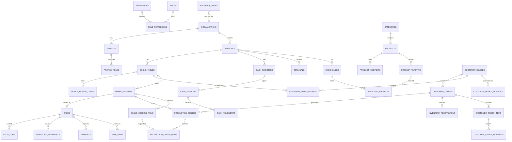

# Esquema de datos PostgreSQL

Estado: **implementado como migraciones versionadas**, verificado en PostgreSQL 19
con `supabase/tests/backend.test.mjs` (19 pruebas en verde al 26 de noviembre de
2026). Las migraciones son la fuente de verdad; este documento las resume.

| Migración | Contenido |
| --- | --- |
| `20261126090000_0001_core_schema.sql` | Esquema base, catálogo, inventario, salón, ventas, caja, auditoría, sync y tablas de cliente |
| `20261126090100_0002_authz_rls.sql` | Helpers `app.*`, roles/permisos por defecto, RLS de lectura y privilegios mínimos |
| `20261126090200_0003_commercial_rpc.sql` | RPC de terminales, venta, inventario, caja, salón y producción |
| `20261126090300_0004_customer_sync.sql` | Pairing, sesiones de dispositivo, menú, pedidos de cliente, cancelación y descarga incremental |

No se ha desplegado en un proyecto Supabase real; ver
[BACKEND_DEPLOYMENT.md](BACKEND_DEPLOYMENT.md).

## 1. Convenciones

- UUID (`gen_random_uuid()`) como clave primaria distribuida.
- `timestamptz` en UTC; la zona horaria de sucursal es dato, no configuración de sesión.
- Importes monetarios `BIGINT` en unidades menores; cantidades `NUMERIC(18,3)`.
- Moneda ISO de 3 letras validada por `CHECK (length(currency) = 3)`.
- `deleted_at` para borrado lógico de catálogos; ventas, movimientos y auditoría
  son append-only (triggers que rechazan UPDATE/DELETE).
- Todas las entidades operativas llevan `organization_id`; las de sucursal,
  además `branch_id`.
- Versionado optimista con `updated_at` y `version` donde aplica; el trigger
  `app.touch_updated_at()` increments `version` solo si la columna existe.

## 2. Diagrama lógico



## 3. Seguridad y organización

```sql
organizations(id uuid pk, name, tax_id, status active|suspended,
  created_at, updated_at, version, deleted_at);

branches(id uuid pk, organization_id fk, name, code, timezone,
  default_currency, status active|suspended, created_at, updated_at,
  version, deleted_at, unique(organization_id, code));

warehouses(id uuid pk, organization_id fk, branch_id fk, name, code,
  status active|inactive, created_at, updated_at, version, deleted_at,
  unique(organization_id, code));

terminals(id uuid pk, organization_id fk, branch_id fk, name,
  token_hash text, platform, app_version, status active|revoked,
  registered_at, last_seen_at, revoked_at, beta_origin_id,
  created_at, updated_at, version, unique(organization_id, name));

profiles(id uuid pk references auth.users(id), organization_id fk,
  display_name, status active|disabled, created_at, updated_at, deleted_at);

profile_branches(profile_id fk, branch_id fk, organization_id fk,
  primary key(profile_id, branch_id));
```

- `terminals.token_hash` guarda SHA-256 del token emitido por
  `rpc_register_terminal`; el texto plano se devuelve una sola vez.
- Un terminal pertenece a una organización y sucursal; revocarlo registra
  `revoked_at` y bloquea todas sus RPC.
- `profile_branches` vacío significa "todas las sucursales de la organización";
  con filas, el perfil solo opera en las listadas.

## 4. Roles y permisos

```sql
roles(id uuid pk, organization_id fk, code, name, is_system,
  created_at, updated_at, unique(organization_id, code));

permissions(id uuid pk, code unique, description, created_at);

profile_roles(profile_id fk, role_id fk, organization_id fk,
  assigned_by fk, assigned_at, primary key(profile_id, role_id));

role_permissions(role_id fk, permission_id fk,
  scope organization|branch, primary key(role_id, permission_id));
```

`app.install_default_roles(org)` crea los 22 permisos y los roles
`org_admin`, `manager`, `cashier`, `waiter`, `kitchen`, `bar`. La matriz exacta
está en [AUTHORIZATION.md](AUTHORIZATION.md). Los roles viven por organización;
no hay roles globales mutables por el cliente.

## 5. Catálogo e inventario

```sql
categories(id uuid pk, organization_id fk, parent_id fk null, name,
  sort_order, active, beta_origin_id, created_at, updated_at, version,
  deleted_at);

products(id uuid pk, organization_id fk, category_id fk, sku, name,
  description, base_currency, price_minor, cost_minor, offline_sellable,
  fulfillment_station KITCHEN|BAR|UNASSIGNED, is_synthetic, active,
  beta_origin_id, created_at, updated_at, version, deleted_at,
  unique(organization_id, sku) where deleted_at is null);

product_variants(id uuid pk, organization_id fk, product_id fk, sku, name,
  price_minor, cost_minor, active, beta_origin_id, created_at, updated_at,
  version, deleted_at);

product_modifiers(id uuid pk, organization_id fk, product_id fk,
  group_name, name, price_delta_minor, min_select, max_select, active,
  created_at, updated_at, version, deleted_at);

inventory_balances(id uuid pk, organization_id fk, warehouse_id fk,
  variant_id fk, quantity_minor, reserved_minor, version, updated_at,
  unique(warehouse_id, variant_id),
  check(reserved_minor >= 0 and reserved_minor <= quantity_minor));

inventory_movements(id uuid pk, organization_id fk, warehouse_id fk,
  variant_id fk, sale_id fk null, customer_order_id fk null,
  movement_type SALE_CONSUMPTION|ADJUSTMENT|RECEIPT|RESERVATION|RELEASE,
  quantity_minor, unit_cost_minor, reason, source_terminal_id fk,
  source_beta_id, idempotency_key, before_version, created_by fk,
  created_at, synced_at, unique(organization_id, idempotency_key));

inventory_reservations(id uuid pk, organization_id fk, warehouse_id fk,
  variant_id fk, customer_order_id fk, quantity_minor, status
  ACTIVE|RELEASED|CONSUMED|EXPIRED, expires_at, released_at, created_at);
```

- `quantity_minor` de inventario usa milésimas de unidad, no dinero.
- `inventory_movements` es append-only; una corrección es otro movimiento.
- `fulfillment_station` decide el enrutamiento: los productos `UNASSIGNED`
  quedan en comanda sin generar orden de producción.
- `is_synthetic` identifica fixtures locales; no se venden ni aparecen en el
  menú de tablet.
- Las reservas de pedidos de cliente expiran en 30 minutos y se liberan al
  cancelar.

## 6. Ventas y pagos

```sql
sales(id uuid pk, organization_id fk, branch_id fk, terminal_id fk,
  cash_session_id fk null, dining_session_id fk null,
  sale_number, status, sale_kind direct|dining, total_currency, total_minor,
  exchange_rate_snapshot_id fk null, beta_origin_id, idempotency_key,
  base_version, created_by fk, created_at, updated_at, closed_at,
  unique(organization_id, idempotency_key));

sale_items(id uuid pk, organization_id fk, sale_id fk, variant_id fk,
  quantity numeric(18,3), unit_price_minor, subtotal_minor, tax_minor,
  line_currency, created_at);

payments(id uuid pk, organization_id fk, sale_id fk, method,
  amount_minor, currency_code, exchange_rate_snapshot_id fk null,
  original_amount_minor, original_currency_code, reference, status,
  idempotency_key, created_at, unique(organization_id, idempotency_key));
```

`rpc_confirm_sale` valida precios y totales contra el catálogo antes de insertar.
Una venta confirmada no se actualiza: la anulación crea su registro compensatorio
(futuro). Los estados de venta son `open`, `paid`, `void_pending`, `voided`,
`sync_conflict`, `closed`; el flujo actual crea `paid`.

## 7. Caja y tasas

```sql
cash_registers(id uuid pk, organization_id fk, branch_id fk, name,
  status, created_at, updated_at, version, deleted_at,
  unique(branch_id, name));

cash_sessions(id uuid pk, organization_id fk, branch_id fk,
  cash_register_id fk, terminal_id fk, profile_id fk,
  opening_minor jsonb, closing_minor jsonb, status OPEN|CLOSED,
  opened_at, closed_at, expected_usd_minor, difference_usd_minor,
  idempotency_key, base_version,
  unique(organization_id, idempotency_key));

create unique index uq_cash_sessions_open_register
  on cash_sessions(cash_register_id) where status = 'OPEN';

cash_movements(id uuid pk, organization_id fk, cash_session_id fk,
  movement_type income|expense|adjustment, category, amount_minor,
  currency_code, sale_id fk null, reason, idempotency_key, created_by,
  created_at, unique(organization_id, idempotency_key));

exchange_rates(id uuid pk, organization_id fk, base_currency,
  quote_currency, rate_numerator bigint, rate_denominator bigint,
  effective_from, effective_to, source, source_reference, created_at,
  created_by);
```

La tasa usa fracción exacta (`rate_numerator / rate_denominator`) para evitar
redondeos flotantes. `rpc_open_cash_session` exige la moneda base de la
organización (USD en el seed) y una sola sesión abierta por caja.

## 8. Auditoría y sincronización

```sql
audit_logs(id uuid pk, organization_id fk, branch_id fk null,
  terminal_id fk null, profile_id fk null, customer_device_id fk null,
  action, entity_type, entity_id, reason, before_json, after_json,
  occurred_at, immutable_hash);

sync_operations(id uuid pk, organization_id fk, terminal_id fk null,
  operation_type, entity_type, entity_id, idempotency_key, schema_version,
  payload, status APPLIED|CONFLICT|REJECTED, conflict_code, applied_at,
  created_at, unique(organization_id, idempotency_key));

sync_receipts(id uuid pk, organization_id fk, terminal_id fk null,
  sync_operation_id fk, idempotency_key, operation_type, entity_id,
  result_status accepted|rejected, remote_version, payload_hash, accepted,
  received_at, unique(organization_id, idempotency_key));

sync_events(id uuid pk, organization_id fk, terminal_id fk null,
  operation_type, entity_type, entity_id, idempotency_key, event_type,
  event_cursor, base_version, payload, received_at);
```

- `audit_logs` y `sync_events` no admiten UPDATE/DELETE (trigger
  `app.reject_mutation`).
- Una clave de idempotencia es **terminal** por organización: si produjo
  `CONFLICT`, un reintento con la misma clave no se reaplica; se exige una clave
  nueva tras reconciliar.
- `sync_receipts` es la respuesta reutilizable; `sync_operations` conserva el
  estado y el payload original, incluido el conflicto.

## 9. Salón y producción

```sql
dining_tables(id uuid pk, organization_id fk, branch_id fk, name, capacity,
  status FREE|OCCUPIED|RESERVED, active, sort_order, created_at,
  updated_at, version, unique(branch_id, name));

dining_sessions(id uuid pk, organization_id fk, branch_id fk,
  dining_table_id fk, terminal_id fk null, profile_id fk null,
  customer_device_id fk null, status OPEN|CLOSED, opened_at, closed_at,
  idempotency_key, base_version,
  unique(organization_id, idempotency_key));

create unique index uq_dining_sessions_open_table
  on dining_sessions(dining_table_id) where status = 'OPEN';

dining_session_items(id uuid pk, organization_id fk, dining_session_id fk,
  variant_id fk, product_name, quantity, unit_price_minor, currency_code,
  fulfillment_station, notes, status
  PENDING|SENT|PREPARING|READY|DELIVERED|CANCELLED, sent_at,
  created_at, updated_at);

production_orders(id uuid pk, organization_id fk, branch_id fk,
  dining_session_id fk, dining_table_id fk, customer_order_id fk null,
  order_number, station KITCHEN|BAR, status
  PENDING|PREPARING|READY|DELIVERED|CANCELLED, created_by,
  created_at, updated_at, ready_at, delivered_at, base_version);

production_order_items(id uuid pk, organization_id fk,
  production_order_id fk, dining_session_item_id fk unique, created_at);
```

Una sesión de mesa solo se cierra al confirmar su venta, dentro de la misma
transacción. Las comandas de productos `KITCHEN`/`BAR` nacen `SENT` y crean una
orden de producción por estación; los `UNASSIGNED` quedan `PENDING`.

## 10. Tablets de cliente

```sql
customer_devices(id uuid pk, organization_id fk, branch_id fk, label,
  device_fingerprint_hash, status ACTIVE|REVOKED, paired_at, revoked_at,
  last_seen_at, unique(organization_id, device_fingerprint_hash));

device_pairing_codes(id uuid pk, organization_id fk, branch_id fk,
  dining_table_id fk, code_hash, status ACTIVE|USED|EXPIRED|REVOKED,
  expires_at, created_by, created_at, used_at, claimed_device_id,
  unique(code_hash) where status = 'ACTIVE');

customer_device_sessions(id uuid pk, organization_id fk,
  customer_device_id fk, token_hash unique, status ACTIVE|REVOKED|EXPIRED,
  issued_at, expires_at, revoked_at, last_seen_at);

customer_table_bindings(id uuid pk, organization_id fk,
  customer_device_id fk, dining_table_id fk, status ACTIVE|REVOKED,
  bound_at, revoked_at, unique(customer_device_id) where status = 'ACTIVE');

customer_orders(id uuid pk, organization_id fk, branch_id fk,
  customer_device_id fk, dining_table_id fk, dining_session_id fk,
  order_number, status RECEIVED|PREPARING|READY|DELIVERED|CANCELLED,
  total_currency, total_minor, idempotency_key, created_at, updated_at,
  unique(organization_id, idempotency_key));

customer_order_items(id uuid pk, organization_id fk, customer_order_id fk,
  variant_id fk, product_name, quantity, unit_price_minor, subtotal_minor,
  line_currency, notes, created_at);

customer_order_modifiers(id uuid pk, organization_id fk,
  customer_order_item_id fk, modifier_id fk, modifier_name,
  price_delta_minor, created_at);
```

- El código de pairing es de 8 dígitos, se guarda hasheado y es de un solo uso.
- El token de sesión es opaco (32 bytes hex) con hash SHA-256 persistido y
  vigencia deslizante de 8 horas.
- El dispositivo no tiene grants directos sobre tablas: solo ejecuta RPC
  `SECURITY DEFINER` que resuelven su organización, sucursal y mesa desde el
  token.
- `customer_device_sessions` no tiene política RLS: ninguna sesión autenticada
  puede leer tokens ni sesiones de dispositivos.

## 11. Índices relevantes

- `(organization_id, created_at desc)` en ventas y operaciones de sync.
- `(organization_id, sku)` único parcial en productos y variantes.
- `(warehouse_id, variant_id)` en inventario.
- `(sale_id)` y `(organization_id, idempotency_key)` en items/pagos.
- `(organization_id, station, status)` en producción.
- `(organization_id, entity_type, occurred_at desc)` en auditoría.
- Únicos parciales para una sesión abierta por caja y por mesa, un código de
  pairing activo por hash y una vinculación activa por dispositivo.

## 12. SQLite espejo

Las migraciones locales v1–v5 están en
`packages/data_local/lib/src/migrations.dart` (ver [SYNC_PROTOCOL.md](SYNC_PROTOCOL.md)).
SQLite usa UUID `TEXT`, enteros para unidades menores, JSON `TEXT`, timestamps
ISO 8601 y `PRAGMA foreign_keys = ON`. La outbox local no se marca `SYNCED`
hasta recibir un recibo válido del servidor.